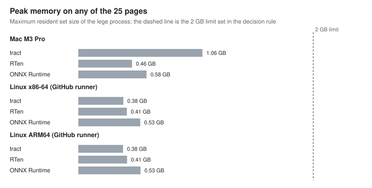

+++
title = "Picking an inference library for an OCR tool"
date = 2026-11-09
updated = 2026-11-12
description = "tract, RTen and ONNX Runtime, measured inside a real OCR pipeline: speed, memory, old CPUs, GPUs, and whether the output stays the same at every thread count"
[taxonomies]
categories = ["Engineering"]
tags = ["rust", "ocr", "onnx", "benchmarking", "reproducibility"]
[extra]
lang = "en"
toc = true
+++

I'm building **Lege**, a command-line OCR tool in Rust. It turns a scanned page into [ALTO](https://www.loc.gov/standards/alto/) XML and plain text, and it promises something most OCR tools don't: the same output every time. Same page, same machine, any number of threads, byte-for-byte identical result. That matters if you're an archive, or if you just want to diff two runs and see nothing.

Lege runs three small neural networks on every page (from Baidu's PP-OCRv5): one finds the text lines, one checks whether each line is upside down, and one reads the characters. Everything around them is Lege's own code. The one thing it borrows is the **inference library** that actually runs the networks, and that choice decides most of the speed, the memory use, whether the "same output" promise can hold, and what you have to ship alongside the binary.

I'd started with [tract](https://github.com/sonos/tract) without measuring anything else. Before making that final, I measured it against [RTen](https://github.com/robertknight/rten) and [ONNX Runtime](https://onnxruntime.ai/). This post is the short version. The full report is [version 2.0 (PDF)](report-v2.0.pdf), and every result file and script behind it is in [the data archive (zip)](lege-inference-runtimes-data-v2.0.zip).

**How this was made.** I designed the study, set the requirements and made the decision. [Claude Code](https://claude.com/claude-code) did most of the hands-on work: it wrote the comparison code and the benchmark scripts, ran the experiments, drafted the report and this post, and ran the reviews described below. Those reviews were the same AI reviewing its own work from three angles, not independent peer review. Every table in the report is generated from the committed result files, so each number can be traced to a measurement.

**The short answer:** ONNX Runtime, using Microsoft's own build, with Lege reading lines in parallel instead of letting the library split each calculation across threads. ONNX Runtime was the fastest by a wide margin on one Linux thread. But its raw output changes slightly with the thread count on some machines, and the parallel-lines design is what makes "same output at any thread count" hold for sure. One condition is still open: on full-size newspaper pages, ONNX Runtime used more memory than my limit allows.

**Update, 12 November 2026 (report version 2.0).** I had three reviews run on the first version: an OCR expert, a Rust and performance expert, and a reviewer of scientific reports. Between them they raised 24 points. All of them are answered in version 2.0. The biggest changes:

- I found *why* ONNX Runtime's output changes with the thread count, and a design that removes the problem for every library (details in [The thread-count surprise](#the-thread-count-surprise)).
- Memory numbers were in GiB but labelled GB. They're now labelled correctly.
- The rule I wrote "in advance" has a clause I wrote after I already knew the result it would rescue. That's now disclosed (details in [The rules](#the-rules-written-down-first)).
- PP-OCRv6's accuracy was rerun with the settings its authors publish. That changed one conclusion.
- Full-size newspaper pages were added as a stress test, and they found the memory problem.

Older versions: [1.0 (PDF)](report-v1.0.pdf), [1.1 (PDF)](report-v1.1.pdf).

## The rules, written down first

Lege has to run on cheap and old computers, not just my laptop. So the requirements were:

1. **Same output at any thread count.** Byte-identical ALTO at 1, 2, 3, 4, 6 and 8 threads, on every machine.
2. **Runs on old CPUs.** Including x86 CPUs with no AVX at all, and ones with AVX but no AVX2 (think ThinkPad X220).
3. **Fits a 4 GB machine.** Under 2 GB peak on any page.
4. **Same text** as the approved test snapshots.

Fail one and you're out. Among the survivors, the winner is whoever's fastest on **one thread on Linux x86-64**, since low-end machines have few cores. I committed that rule to the repository before the second round of results came in, so I couldn't bend it afterwards.

That's true, but incomplete. When I wrote the rule I'd already seen my laptop's results, and they showed ONNX Runtime, in the copy I was using, failing requirement 1. The rule includes a clause saying ONNX Runtime is judged "by the build Lege would ship", and I wrote it knowing it would keep ONNX Runtime in. I think the clause is right on engineering grounds, since I'd never ship that copy. But without it, the rule would have picked RTen. You should know that.

## How I measured

The fair way to compare inference libraries is inside the real program, not with a toy. Lege keeps all its inference calls behind four functions, so I wrote a second version of those four for RTen and for ONNX Runtime, picked at build time. Everything else stays identical.

Then I ran the real command line, one process per page, over the 25 images in Lege's acceptance tests: 20 scanned book pages from 1871 to 1920 in five languages, plus five synthetic lines. Each page got a warm-up run and three timed runs, and the libraries **took turns page by page**. (That last detail turned out to matter a lot; more below.)

Machines: an Apple M3 Pro laptop, GitHub's Linux runners for x86-64 and ARM64, and QEMU emulating two old Intel CPUs, to see whether anything crashes on hardware that lacks the newer instructions.

## The first finding was a bug in my code

tract was slowest everywhere at first, by a lot. It turned out most of that wasn't tract.

Each text line gets scaled to 48 pixels high, so every line has a different width, and tract prepares a model for one exact input shape. Lege was rebuilding the line-reading model from scratch for nearly every line: parsing the ONNX file and running all of tract's optimization passes, about 80 ms each time. On one 34-line page, **2.0 of its 3.4 seconds** went to rebuilding the model, not to reading text.

The fix: do the expensive, width-independent preparation once, and for each new width only plug in the number and run the last, quick pass. Same output, byte for byte. tract's time for the 25 pages dropped from 73 s to 48 s on one thread, and from 60 s to 35 s on four.

That fix is partial. tract still runs that last pass for every new width. The review pushed me to try rounding widths up to multiples of 32. That's 13% faster and uses less memory, but it changes the output on 7 of 25 pages, so it can only ever be an opt-in setting.

The lesson I keep relearning: benchmark the whole program, because the slow part is often yours.

## Results

Here's version 1's total time for all 25 pages on each machine. The light dot is one thread; the dark dot is the most threads the machine could actually use.

For version 2.0 I reran the speed tests with **Microsoft's build** of ONNX Runtime, the one Lege would ship (version 1 had timed a copy built by Nix):

| 25 pages, total | tract | RTen | ONNX Runtime |
|---|---|---|---|
| Linux x86-64, 1 thread | 126.7 s | 99.6 s | 55.4 s |
| Linux ARM64, 1 thread | 149.6 s | 115.5 s | 99.3 s |
| Mac M3 Pro, 4 threads | 38.0 s | 23.5 s | 22.3 s |

- **On one Linux x86-64 thread, ONNX Runtime is far ahead.** RTen took 1.80 times as long (95% interval 1.76–1.84), tract 2.29 times. On ARM64 the lead is smaller (1.16 times).
- **On the Mac at four threads, RTen and ONNX Runtime are close.** tract trails.
- **The noise is small.** Each figure is the median of three full runs. Those runs differed by 0.4% in the typical case and at most 4.1%, so the 10% tie margin in my rule has room to spare.
- **Tuning didn't change the picture.** Link-time optimization, RTen's prepacked weights, ONNX Runtime's memory planning, and caching its optimized graphs on disk were all within noise or a couple of percent. Letting ONNX Runtime's threads spin instead of sleep saved 9% at four threads.
- **GitHub's runners are small.** For a private repository, they have two cores (on x86-64, one physical core with two hardware threads). The CPU model also changed between jobs, so I only compare numbers from the same job.

**Memory** was fine with these networks on these pages. Everything peaked well under the 2 GB limit (1.86 GiB). tract's 1.05 GiB peak on my Mac turned out to be mostly how macOS counts memory. On Linux the same work peaked at 0.38 GiB.

And the most important result is the boring one: **all three read exactly the same text** on every page, on every machine. The only differences anywhere were tiny shifts in confidence scores, and those also differ *between* machines. If you archive OCR output made on different computers, compare the text, not the bytes.

## The thread-count surprise

This was the requirement I expected everyone to pass, and the one that nearly decided everything.

I ran every page at 1, 2, 3, 4, 6 and 8 threads and compared the ALTO files byte for byte against the 1-thread run. tract and RTen were identical every time, on every machine. ONNX Runtime was identical on both Linux machines, but on my M3 Pro one page came out different at **exactly four threads**, and only at four: a single confidence score went from 0.2968 to 0.2967. The text was the same. The file wasn't, and "the same file every time" is the promise.

The copy of ONNX Runtime I'd been using came from Nix, the package manager I build with. Microsoft's build of the same version passed that check everywhere, including on my laptop. Version 1 stopped there.

**Version 2.0 looked underneath.** ALTO rounds confidences to four decimals, and that can hide small differences. So I had Lege dump every raw number the networks produce and compared those, bit for bit, across thread counts:

- **tract and RTen:** identical at 2, 4 and 8 threads, everywhere.
- **ONNX Runtime, Microsoft's build, on x86-64:** identical.
- **ONNX Runtime, Microsoft's build, on ARM64** (a Linux runner and a GitHub Mac runner): up to 47 of 523 network outputs differ.
- **ONNX Runtime, the Nix build on my Mac:** up to 260 of 523 differ.

The differences are tiny, under 0.00006, and rounding almost always hides them. "Almost" is the problem: once in a while a value sits right on a rounding boundary, and the file changes. That's what happened on my laptop, and with PP-OCRv6's networks it happened with Microsoft's build too (more below).

**Why?** I exposed every intermediate value inside the recognizer and found the first one that differs. It comes out of one particular matrix multiply, while an almost identical one just before it, half the size, is fine. Floating-point addition gives slightly different answers in a different order. ONNX Runtime splits the sums inside a large matrix multiply across threads, so the order depends on the thread count, the matrix size and the CPU's kernels. That's why the problem appears and disappears with the network, the build and the chip.

**The fix is a design change, not a library choice.** Two of the reviews suggested the same thing: run every network call on *one* thread, and use the other threads to read several lines at once. Each line is then computed exactly as it would be on one thread, whatever the thread count, so the output can't depend on it. With that change, raw outputs were bit-identical at every thread count **for all three libraries**, including Microsoft's ONNX Runtime on ARM64, where it had differed before.

It costs speed with several threads: ONNX Runtime took about a third longer at four threads on my Mac, mostly because the line finder, which runs once per page, now gets only one thread. On one thread it costs nothing, by construction. That's the trade I'll take for a promise that holds by design rather than by testing.

## Newspapers

The test pages are small book pages, so I added three full-size newspaper front pages from the Library of Congress's [Chronicling America](https://www.loc.gov/collections/chronicling-america/), up to 5,880 × 8,600 pixels and 855 text lines. There's no transcription for them, so this measures only time, memory and consistency.

Every library gave the same output at one and two threads, and ONNX Runtime was again the fastest. But **ONNX Runtime peaked at 2.07 GiB** on the two big pages, over my 2 GB limit (RTen 1.67 GiB, tract 1.25 GiB). Lege's own memory was only 0.35 GiB of that; the rest is ONNX Runtime's working memory for the line finder on a very large image. The requirement was written for the test pages, where ONNX Runtime passes. But a 4 GB machine reading newspapers is exactly what it was meant to protect.

## Old CPUs

I don't have an old machine to test on, so I emulated two with QEMU: a **Nehalem** CPU (2008-era, no AVX at all) and a **SandyBridge** CPU (2011, the ThinkPad X220 generation: AVX but no AVX2). A small program confirmed that the emulated CPU really reports those instructions as missing.

All three libraries ran every test page correctly on both, with the right text. Inference libraries pick their fast code paths at run time based on what the CPU supports, and if any of them had used an instruction the CPU lacks, the run would have crashed. None did.

Emulation is 10 to 50 times slower than real hardware, so this proves correctness, not speed. I decided not to time a real old laptop for this round. That leaves a real gap: my ranking uses one thread of a modern server CPU as a stand-in for a low-end machine, and an old laptop without AVX2 might not rank the libraries the same way.

## What about the GPU?

I tried tract on Apple's Metal and ONNX Runtime with Apple's Core ML (GPU and Neural Engine). Both read exactly the same text. Neither was worth it:

The networks are the small "mobile" versions, and Lege reads one line at a time, so shipping each line to the GPU and back costs about as much as the actual work. Batching lines together might change that, but batching pads every line to the same width, which changes the output. That breaks the "same output" promise, so at most it could be an opt-in setting. I didn't test NVIDIA.

## What I got wrong

The first round's own review found four problems:

- **Run order.** I'd run each library as one block, one after another. With the libraries taking turns instead, RTen's one-thread time went from **74 s to 54 s** with nothing else changed, most likely because the laptop had heated up and slowed down by the time RTen's block came round. If you benchmark on a laptop, interleave.
- **A flattering warm-up.** My first GPU test re-read the same page, so tract already had every line width prepared and looked faster than it is.
- **The wrong baseline.** I compared the GPU against one CPU thread instead of the CPU at its best.
- **A handicap.** I'd turned off one of ONNX Runtime's threading settings, which cost it about 12% at four threads.

The three reviews behind version 2.0 found more. Here are the ones I'd most want to have caught myself:

- **Wrong units.** I divided by 2³⁰ and wrote "GB".
- **An overstated abstract.** It said "ran on CPUs without AVX" when the CPUs were emulated, and "under 2 GB" when that only held for one generation of networks.
- **Averages that hid the counts.** I reported error rates to four decimals from a few thousand characters. Version 2.0 gives raw counts and intervals instead.
- **Wrong PP-OCRv6 settings.** I ran PP-OCRv6 with the wrong box threshold for two of its three sizes.

## The decision

Under the rule I wrote down in advance (including the clause above), ONNX Runtime with Microsoft's build passes every requirement on the test pages and wins on speed by far more than the tie margin.

So **Lege will use ONNX Runtime, shipping Microsoft's official build**, pinned by version and checksum, **with lines read in parallel and each network call on one thread**. That design was chosen after seeing the data, not by the original rule. It comes with four conditions:

1. **A raw-output check in CI.** On every supported machine, with the shipped library and every model, raw outputs at 1, 2, 4 and 8 threads must be bit-identical. With the new design they always should be; the check catches regressions.
2. **A fixed place to load the library from.** Lege loads ONNX Runtime from next to its own binary, and refuses to run if the version or checksum isn't the pinned one. It never picks up a library of the same name from the system.
3. **Fix the memory on big pages.** ONNX Runtime has to get under the limit on newspaper-sized pages (by turning off its memory pool, or reading huge pages in tiles) before it ships. If that fails, my own rule points to RTen.
4. **Win back multi-thread speed** by overlapping the next page's line finding with the current page's reading. That doesn't change any output.

It isn't free. Lege stops being one self-contained binary: it ships a 28 MB C++ library, and its output depends on a build I don't compile. If that proves impractical somewhere, the fallback is RTen. It's pure Rust, has nothing extra to ship, came second on one thread, and gave bit-identical raw outputs in every check I ran.

## PP-OCRv6

Baidu released PP-OCRv6 in June 2026, in three sizes: tiny, small and medium. Before calling the choice done, I reran the comparison with it. This part is exploratory: I chose what to run and how to score it after seeing version 1's results.

There's a catch for Lege first. PP-OCRv6 has no Latin-only text reader. Its dictionaries are 85–89% Chinese characters, against the 836-character Latin dictionary Lege uses now. So I also tried a **hybrid**: the new v6 line finder paired with Lege's current v5 Latin reader.

**Should Lege switch?** Here's how many characters each set got wrong on 12 scanned pages (16,080 characters), with PP-OCRv6's published settings:

| Models | Characters wrong | Error rate (95% interval) |
|---|---|---|
| v5 (current) | 58 | 0.36% (0.20–0.66%) |
| v6 tiny | 195 | 1.21% (0.72–1.83%) |
| v6 small | 78 | 0.49% (0.23–0.82%) |
| v6 medium | 60 | 0.37% (0.21–0.56%) |
| v6 line finder + v5 reader (small) | 37 | 0.23% (0.16–0.32%) |

The transcriptions were made by correcting v5's output against the book, so they lean towards v5. Nobody has checked them independently yet; there's a checklist for that in the archive.

- **The full v6 sets are no better than v5.** Medium is level, small slightly behind, and tiny clearly worse. Tiny also garbles a perfectly clean synthetic line with every threshold I tried.
- **The hybrid might be better.** It got 37 characters wrong against v5's 58, despite the transcriptions favouring v5, and its line counts match the page more closely. But the interval for the difference just includes zero, and most of the gap comes from two pages. Version 1.1 said the hybrid "reads as well as v5"; with the right settings, it's the first candidate that might beat it. It changes the output on most test images, though, so switching means re-approving every snapshot. Lege stays on v5 until the transcriptions are checked and the test set is broader.
- **Medium needs a lot of memory with tract:** 2.65 GiB on Linux, over the limit. tract keeps a separately optimized copy of the network for each line width it has seen. Rounding widths to multiples of 32 brings that down to 1.62 GiB. RTen and ONNX Runtime stay under the limit.

**Does the library choice survive?** The speed order didn't change. And the thread-count results with v6 are what made me look underneath. With the library's own threading, Microsoft's ONNX Runtime build changed its output on three of six model sets, on my Mac and on GitHub's ARM64 runner. With lines in parallel, v6 small, the set I rechecked that way, came out identical at every thread count.

## Caveats

- 25 images is enough to rank three libraries whose runs vary by under 5%, but it's a small, fairly uniform set: mostly English-language books from one era. Three newspaper pages test scale, not accuracy.
- GitHub's runners for a private repository are small and shared, and their CPU model changes from job to job.
- My Mac has two kinds of cores, and I didn't control which ones the threads ran on.
- Emulation proves the code doesn't crash without AVX; it says nothing about real speed on an old machine.
- The reviews were an AI checking its own work. They found real problems, but they aren't independent review. If you spot something, I'd like to hear about it.

The full report is [version 2.0 (PDF)](report-v2.0.pdf), with every table generated straight from the result files in [the data archive (zip)](lege-inference-runtimes-data-v2.0.zip). Lege's source isn't public yet, so the archive lets you check every number and rerun every analysis, but not rerun the benchmarks themselves.
