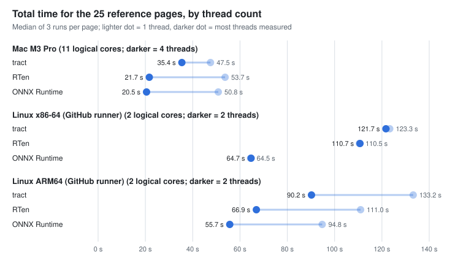
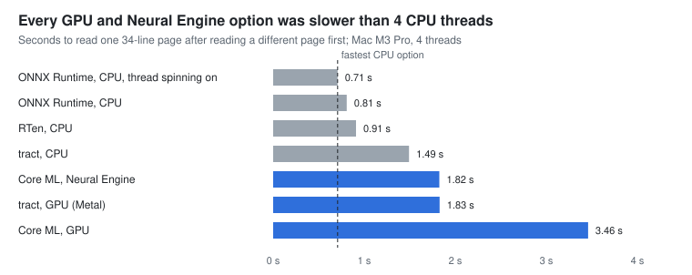

+++
title = "Picking an inference library for an OCR tool"
date = 2026-11-09
description = "tract, RTen and ONNX Runtime, measured inside a real OCR pipeline: speed, memory, old CPUs, GPUs, and whether the output stays the same at every thread count"
[taxonomies]
categories = ["Engineering"]
tags = ["rust", "ocr", "onnx", "benchmarking", "reproducibility"]
[extra]
lang = "en"
toc = true
+++

I'm building **Lege**, a command-line OCR tool in Rust. It turns a scanned page into [ALTO](https://www.loc.gov/standards/alto/) XML and plain text, and it promises something most OCR tools don't: the same output every time. Same page, same machine, any number of threads, byte-for-byte identical result. That matters if you're an archive, or if you just want to diff two runs and see nothing.

Lege runs three small neural networks on every page (from Baidu's PP-OCRv5): one finds the text lines, one checks whether each line is upside down, and one reads the characters. Everything around them is Lege's own code. The one thing it borrows is the **inference library** that actually runs the networks, and that choice decides most of the speed, the memory use, whether the "same output" promise can hold, and what you have to ship alongside the binary.

I'd started with [tract](https://github.com/sonos/tract) without measuring anything else. Before making that final, I measured it against [RTen](https://github.com/robertknight/rten) and [ONNX Runtime](https://onnxruntime.ai/). This post is the short version; the full report is [here as a PDF](report.pdf).

**The short answer:** ONNX Runtime, using Microsoft's own build. It was the fastest by a wide margin on one Linux thread, and it passed every requirement, but only Microsoft's build did. The copy I'd been using, built by Nix, changed one number in the output at exactly four threads on my laptop, and that alone would have ruled it out.

## The rules, written down first

Lege has to run on cheap and old computers, not just my laptop. So the requirements were:

1. **Same output at any thread count.** Byte-identical ALTO at 1, 2, 3, 4, 6 and 8 threads, on every machine.
2. **Runs on old CPUs.** Including x86 CPUs with no AVX at all, and ones with AVX but no AVX2 (think ThinkPad X220).
3. **Fits a 4 GB machine.** Under 2 GB peak on any page.
4. **Same text** as the approved test snapshots.

Fail one and you're out. Among the survivors, the winner is whoever's fastest on **one thread on Linux x86-64**, since low-end machines have few cores. I committed that rule to the repository before the second round of results came in, so I couldn't bend it afterwards.

## How I measured

The fair way to compare inference libraries is inside the real program, not with a toy. Lege keeps all its inference calls behind four functions, so I wrote a second version of those four for RTen and for ONNX Runtime, picked at build time. Everything else stays identical.

Then I ran the real command line, one process per page, over the 25 images in Lege's acceptance tests: 20 scanned book pages from 1871 to 1920 in five languages, plus five synthetic lines. Each page got a warm-up run and three timed runs, and the three libraries **took turns page by page**. (That last detail turned out to matter a lot; more below.)

Machines: an Apple M3 Pro laptop, GitHub's Linux runners for x86-64 and ARM64, and QEMU emulating two old Intel CPUs, to see whether anything crashes on hardware that lacks the newer instructions.

## The first finding was a bug in my code

tract was slowest everywhere at first, by a lot. It turned out most of that wasn't tract.

Each text line gets scaled to 48 pixels high, so every line has a different width, and tract prepares a model for one exact input shape. Lege was rebuilding the line-reading model from scratch for nearly every line: parsing the ONNX file and running all of tract's optimization passes, about 80 ms each time. On one 34-line page, **2.0 of its 3.4 seconds** went to rebuilding the model, not to reading text.

The fix: do the expensive, width-independent preparation once, and for each new width only plug in the number and run the last, quick pass. Same output, byte for byte. tract's time for the 25 pages dropped from 73 s to 48 s on one thread, and from 60 s to 35 s on four.

The lesson I keep relearning: benchmark the whole program, because the slow part is often yours.

## Results

Here's the total time for all 25 pages on each machine. The light dot is one thread; the dark dot is the most threads the machine could actually use.

Three things stand out:

- **On one thread, ONNX Runtime is far ahead on Linux**: 64.5 s on x86-64, against 110.5 s for RTen and 123.3 s for tract. On the Mac the three are within 13% of each other, which is a good reminder not to benchmark only on your own laptop.
- **With more threads, RTen and ONNX Runtime pull away from tract.** On the Mac at four threads: 20.5 s for ONNX Runtime, 21.7 s for RTen, 35.4 s for tract.
- **GitHub's runners are small.** For a private repository, the x86-64 runner was a single physical core with two hardware threads, so a second thread did nothing there.

Memory was never a problem: everything stayed far under the 2 GB limit, with RTen the leanest on the Mac (0.46 GB) and all three between 0.38 and 0.53 GB on Linux.

And the most important result is the boring one: **all three read exactly the same text** on every page, on every machine. The only differences anywhere were tiny shifts in confidence scores.

## The thread-count surprise

This was the requirement I expected everyone to pass, and the one that nearly decided everything.

I ran every page at 1, 2, 3, 4, 6 and 8 threads and compared the ALTO files byte for byte against the 1-thread run. tract and RTen were identical every time, on every machine. ONNX Runtime was identical on both Linux machines, but on my M3 Pro one page came out different at **exactly four threads**, and only at four: a single confidence score went from 0.2968 to 0.2967. The text was the same. The file wasn't, and "the same file every time" is the promise. Running it three more times gave the same result each time, so it wasn't noise, and ONNX Runtime's "deterministic compute" switch didn't change it.

The copy of ONNX Runtime I'd been using came from Nix, the package manager I build with. But Lege would ship whatever build works, so I repeated the check with **Microsoft's official build** of the same version, on every machine: my M3 Pro, a GitHub Mac runner (an M2 Pro), and both Linux runners, where I also built Lege without Nix. Microsoft's build gave identical output everywhere, including on my laptop. Oddly, the Nix build was fine on the M2 Pro too, so the problem needed both that build and that chip. I didn't track down why.

The takeaway: "same output at any thread count" isn't something you can read off a library's feature list. You have to check it on each machine, with the exact binary you ship. A problem that shows up on one chip at one thread count is easy to miss.

## Old CPUs

I don't have an old machine on my desk yet, so I emulated two with QEMU: a **Nehalem** CPU (2008-era, no AVX at all) and a **SandyBridge** CPU (2011, the ThinkPad X220 generation: AVX but no AVX2). A small program confirmed that the emulated CPU really reports those instructions as missing.

All three libraries ran every test page correctly on both, with the right text. Inference libraries pick their fast code paths at run time based on what the CPU supports, and if any of them had used an instruction the CPU lacks, the run would have crashed. None did.

Emulation is 10 to 50 times slower than real hardware, so this proves correctness, not speed. Real timings on a real X220 are the next thing to measure.

## What about the GPU?

I tried tract on Apple's Metal and ONNX Runtime with Apple's Core ML (GPU and Neural Engine). Both read exactly the same text. Neither was worth it:

The networks are the small "mobile" versions, and Lege reads one line at a time, so shipping each line to the GPU and back costs about as much as the actual work. Batching lines together might change that, but batching pads every line to the same width, which changes the output. That breaks the "same output" promise, so at most it could be an opt-in setting. I didn't test NVIDIA.

## What I got wrong the first time

I ran an adversarial review of my own first round, and it found real problems:

- **Run order.** I'd run each library as one block, one after another. With the libraries taking turns instead, RTen's one-thread time went from **74 s to 54 s** with nothing else changed, most likely because the laptop had heated up and slowed down by the time RTen's block came round. If you benchmark on a laptop, interleave.
- **A flattering warm-up.** My first GPU test re-read the same page, so tract already had every line width prepared and looked faster than it is.
- **The wrong baseline.** I compared the GPU against one CPU thread instead of the CPU at its best.
- **A handicap.** I'd turned off one of ONNX Runtime's threading settings, which cost it about 12% at four threads.

None of these changed the GPU verdict, but they changed the CPU picture enough that I wouldn't have trusted the first round's conclusion.

## The decision

Under the rule I wrote down in advance:

- **Requirements:** tract and RTen pass everything everywhere. ONNX Runtime passes everything with Microsoft's build, and fails with the Nix build.
- **Ranking:** on one Linux x86-64 thread, ONNX Runtime took 64.5 s, RTen 110.5 s and tract 123.3 s. That's far outside the 10% tie margin, so it ends there. ONNX Runtime was also fastest on the Mac at four threads.

So **Lege will use ONNX Runtime, shipping Microsoft's official build**, pinned by version and checksum.

It isn't free. Lege stops being one self-contained binary: it now ships a 28 MB C++ library, and its output depends on a build I don't compile. To keep the "same output" promise honest, the thread-count check becomes part of Lege's CI on every supported machine, with the exact library it ships, and no ONNX Runtime upgrade lands without passing it.

One caveat on the speed numbers: I timed the Nix build. Microsoft's build was checked for correct and identical output, not timed. It's the same version, and ONNX Runtime's lead is over 40%, so I'd be surprised if that changed the ranking, but I haven't measured it. If shipping the C++ library turns out to be impractical somewhere, the rule's runner-up is RTen: pure Rust, nothing extra to ship, and about 12% faster than tract on one thread.

## Caveats

- 25 images is enough to rank three libraries whose runs vary by under 2%, but it's a small, fairly uniform set: mostly English-language books from one era. Newspapers and dense layouts aren't in it.
- GitHub's runners for a private repository are small and shared, so Linux timings are rougher than the Mac's.
- Emulation proves the code doesn't crash without AVX; it says nothing about real speed on an old machine. That needs real old hardware, which is next.

The full report, with every table generated straight from the benchmark's result files, is [here (PDF)](report.pdf).
